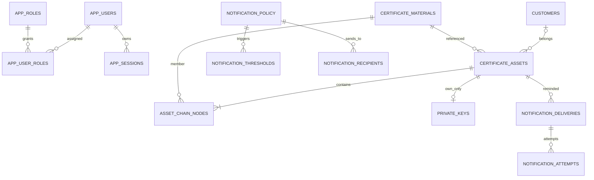

# 数据库表设计

> 当前口径（2026-11-14）：实际迁移为 V1–V10，共 36 张业务/辅助表，不含 Flyway 自身表。V10 是 `src/main/java/db/migration/V10__ssh_shell_steps.java`，调整 SSH 类型约束而不新增表。下文 V1/V4/V5 表数量和字段说明保留对应阶段背景；`app_sessions`、`scheduler_state` 目前预留。完整核对见[需求与设计核对基线](requirements-design-review-2026-11-14.md)。

## 当前迁移索引

| 版本 | 变化 | 新增表数 |
| --- | --- | --- |
| V1 | 基础账号、客户、证书、SMTP、通知、操作审计等；下文字典描述此阶段 | 19 |
| V2 | `certificate_assets.deleted_at`，逻辑删除 | 0 |
| V3 | 秘密集合、服务器、连接版本及信任材料引用 | 4 |
| V4 | 流程、步骤、引用、执行快照、步骤结果及互斥锁 | 11 |
| V5 | 统一摘要 `execution_logs` | 1 |
| V6 | 客户 `external_id`、`id_type` | 0 |
| V7 | 证书 `enabled` | 0 |
| V8 | 证书 `archived_at` | 0 |
| V9 | 原始审计 `execution_log_raw` 及摘要的 `raw_trace_id` 关联 | 1 |
| V10 | Java 迁移，扩展服务器协议及步骤类型白名单以接受 SSH | 0 |

当前以 `src/main/resources/db/migration` 的 V1–V9 SQL 与 `src/main/java/db/migration` 的 V10 Java 迁移为执行来源。`doc/sql` 为 SQL 文档副本；不要因没有 V10 SQL 副本而补建重复迁移。以下是历史阶段设计与基础字段字典。

> V5新增统一日志表 `execution_logs`，核心列 `actor_name`（执行人）、`occurred_at`（执行时间）、`message`（内容描述）；额外来源、结果及关联ID仅用于筛选与追踪。旧操作审计及已有执行结果快照迁入，后续所有操作/执行事件汇总至此表。脚本为 `sql/V5__execution_audit_logs.sql`，不提供更新删除API；原 `audit_events` 作为兼容记录保留。当前总计35张业务/辅助表。

> 2026-11-09扩展：服务器和同步流程的数据表提案见 `server-sync-design.md` 第8节，待设计确认后实施新迁移；本文件下列基础表为已有MVP模型。

> 扩展实施完成：新增 `sql/V3__managed_servers.sql`（加密秘密集合、服务器、不可变连接版本、信任材料引用）和 `sql/V4__sync_workflows.sql`（任务/步骤、显式引用、执行快照和步骤结果、调度互斥锁）。现有H2已验证V2升级V4；总计34张业务/辅助表，不含Flyway自身表。部署使用classpath下同名Flyway脚本，不手工重跑V1。

版本：1.0（设计稿）  
日期：2026-11-08  
数据库：H2 2.x 文件模式，单应用实例  
依据：`requirements.md`、`design.md`  
建表脚本：`sql/V1__initial_schema.sql`（全新数据库执行一次，后续修改通过新迁移脚本）

## 1. 设计约定

- 表名与字段采用 snake_case，避开 user、key、value 等易冲突命名；主键通常为 BIGINT 自增，关联表可采用联合主键。
- 时间戳使用 TIMESTAMP WITH TIME ZONE，应用统一按 UTC 写入、按配置时区展示；日期与日内时间分别使用 DATE、TIME。
- 公钥证书规范化为 DER 存 BLOB，长 DN、结构化扩展及响应快照使用 CLOB；JSON 文本由应用验证，避免依赖数据库 JSON 转换行为。
- CN 为展示名称，不唯一，不可人工改写；证书材料按 SHA-256 指纹唯一，新旧证书以不同材料和资产独立并列。
- purpose 枚举为 AS2、HTTPS、GENERAL（界面显示通用）；owner_type 为 OWN、CUSTOMER；certificate_kind 为 ROOT、INTERMEDIATE、LEAF。
- 不设置证书版本、替换关系或使用状态。有效期状态由 not_before、not_after、warning_days 和当前时间实时计算，不持久化状态列。
- 所有外键默认阻止删除关联数据，不使用级联删除证书、客户、发送记录或审计记录。MVP 用户停用、客户无删除；证书删除归档规则另定。
- 表中 config_revision 是配置并发控制计数，不是证书版本。updated_at 由应用更新，数据库默认值只负责插入时间。
- H2 identity 和约束语法参考 [H2 SQL Grammar](https://h2database.com/html/grammar.html)、[H2 Commands](https://h2database.com/html/commands.html)。未选定最终 H2 补丁版本，迁移需在最终版本上执行验证。

## 2. 表清单及职责

| 表 | 用途 |
| --- | --- |
| app_users | 内部账号及会话失效计数 |
| app_roles | 角色扩展，MVP 仅 ADMIN |
| app_user_roles | 用户角色关联 |
| app_sessions | 数据库会话令牌哈希及有效期 |
| app_bootstrap | 首次管理员初始化标识 |
| customers | 客户名称、规范化唯一键及描述 |
| certificate_materials | 不可变公钥材料和解析属性 |
| certificate_assets | 业务归属、用途、分类及签发关联 |
| asset_chain_nodes | 每个资产的确定证书链 |
| private_keys | 仅自有资产的加密私钥 |
| smtp_config | 单例 SMTP 服务配置及加密凭据 |
| notification_policy | 单例通知服务策略 |
| notification_thresholds | 多个提前提醒节点 |
| notification_recipients | 多个通知收件人 |
| notification_deliveries | 按证书、节点、收件人去重的投递任务 |
| notification_attempts | 每次发送尝试及失败、不确定结果 |
| scheduler_state | 扫描进度及数据库租约 |
| operation_requests | 导入和签发幂等成功结果 |
| audit_events | 脱敏操作审计 |

共 19 张表。实体命名在本文件细化：设计文档原 users/sessions 对应 app_users/app_sessions，import_requests 泛化为 operation_requests 以同时支持签发；通知节点和收件人拆表，不在策略列中保存逗号列表。

## 3. 核心关系

每个资产链节点按根到当前证书排序，位置从 1 开始，根资产链含自身，中间资产链含根和自身，叶子资产链含完整上级及自身。客户只创建 LEAF 资产，中间和根仅作为材料进入链表。自有导入按层建立资产，仅上传终端私钥时，根和中间无 private_keys 记录，不能用于签发。

issuer_material_id 表达直接上级公钥材料；issuer_asset_id 可选，仅在存在明确自有签发资产时引用。根的 issuer_material_id 指向自身材料，issuer_asset_id 留空。密码学关系、同归属和类型约束由服务端验证，不单靠外键推断。

## 4. 唯一性与隔离

- 材料指纹采用小写十六进制 64 字符，应用校验格式，唯一索引阻止材料重复。
- scope_key：自有固定 OWN，客户固定 CUSTOMER:<customer_id>。CHECK 保证与归属和客户一致，UNIQUE(scope_key,material_id) 实现空 customer_id 下也可靠去重，不依赖 NULL 的唯一性语义。
- 同一客户及材料只建一个资产；其他客户可共享公钥材料但有独立资产。当前一个资产一个用途，是设计默认，待业务确认多用途时再扩展关联表。
- private_keys 通过 (own_asset_id,owner_type) 联合外键关联资产，并强制 owner_type=OWN，从数据库层禁止客户资产拥有私钥。
- 公钥材料共享不意味着私钥或业务权限共享，客户详情接口不关联返回私钥。
- 客户 name_key 由应用统一 trim、Unicode 规范化和大小写折叠后生成；规范化细则为设计建议。并发新建以唯一约束处理，不能仅依赖先查后插。
- 证书 CN、not_after 相同也允许并列，只要指纹不同；列表通过材料 not_after、资产 id 升序查询。

## 5. 数据库与应用的约束边界

SQL 约束负责归属、客户必填、枚举、单例配置、唯一性及外键。以下跨行及密码学条件由应用在事务内保证：

- chain_depth 等于完整链节点数，位置连续，末节点等于资产 material_id；根、中间、叶子的角色与材料 CA 属性一致。
- 签名、CA约束、链完整性、CN提取和私钥匹配；nonce 使用安全随机生成，GCM tag 随 ciphertext 保存，加密密钥不入库。
- 签发者须有私钥且整条链有效；生成同一签发者下序列号不得重复，事务保存时检查 issuer_material_id + serial_hex，必要时使用签发者锁，重新生成冲突序列号。
- 更新配置使用 config_revision 条件更新；禁止前端编辑证书材料和 CN。
- 停用或重置密码递增 auth_epoch；认证比对会话快照与用户当前值，并检查 enabled、expires_at；用户角色变更也应失效旧会话。
- 客户改名只改 customers，证书通过外键展示新名称；客户导入失败整体回滚自动新增客户。

## 6. 通知数据设计

notification_policy、smtp_config 的 id 固定为 1。节点及收件人分表避免重复，enabled 初始关闭。warning_days 用于列表即将过期阈值，include_ca 明确 CA 范围；这些参数尚未最终确认，SQL 不硬编码业务默认值。

投递去重键为 asset_id + not_after_snapshot + threshold_days + recipient_key。策略调整不清除已成功任务；发送记录保存 CN、客户名、用途和到期时间快照，以免客户改名影响历史展示。sender、SMTP秘密不写入投递日志。

任务状态为 PENDING、SENDING、SENT、RETRY_WAIT、FAILED。每次尝试在 notification_attempts 保留 STARTED、SUCCESS、FAILURE 或 UNKNOWN，结束时更新同一尝试行。抢占租约与 attempts 递增原子执行，工作线程使用 lease_owner 比对后更新；过期租约恢复时将未结束尝试标记 UNKNOWN。

SMTP已接收但数据库未成功落库时仍可能重复邮件，不承诺严格恰好一次。message_id 在任务内保持不变；SENT 不允许重试。收件人规范化规则需保留邮箱本地部分语义，默认只对域名做大小写规范化，不能无条件将整个邮箱转为小写。

scheduler_state.last_scan_date 记录配置时区下成功扫描日期，不是证书日期；补发范围按最终策略实现。重试时间使用 UTC 时间戳。

## 7. 初始化、幂等及事务

SQL 只初始化 ADMIN 角色。应用首次启动在事务内建立 admin / 123456 的密码哈希、角色关联和 app_bootstrap 标记，重复启动不重置已有密码。数据库连接凭据不等于应用账号。

operation_requests 只保存成功结果，与资产同事务提交；唯一键为 actor_id、operation_type、request_key。同键同摘要返回已保存结果，不同摘要返回冲突。请求摘要排除明文密码；签发摘要来自规范化输入，不来自随机生成结果。导入完成返回的主 asset_id 为终端，其他自有 CA id 可放入无秘密 response_json。

验证和密钥生成在事务外执行，持久化短事务内复核并保存；失败不保留半成品。审计成功与业务同事务，失败审计在回滚后单独写入，数据库故障时只能输出脱敏应用日志。

## 8. 索引、查询和维护

- certificate_materials(not_after,id)：到期扫描及排序，配合资产 owner/kind 和 customer/purpose 索引过滤。
- asset_chain_nodes(asset_id,node_position)：详情及展开；material_id 索引支持共享材料反向查找。
- notification_deliveries(status,next_attempt_at,lease_until)：领取和恢复；asset_id/created_at 支持证书发送历史。
- 会话按 user_id 和 expires_at 查询或清理，审计按 created_at 分页。
- 索引为初始设计，数据规模确定后结合实际执行计划优化，不因“最佳实践”预建大量无用索引。
- BLOB、CLOB 不进入列表 DTO；分页先查询结构化属性，导出时单独读取材料和加密私钥。
- 原始上传文件及解密密码不入库。独立备份 H2 与密钥，恢复后验证材料、链及秘密可用。

## 9. 待确认及执行边界

业务待定项仍以需求文档为准：CN异常处理、多用途、多客户关联、长链、过期导入、CA补充私钥、导出格式、通知参数和保留期限。当前 SQL 支持真实层数及可选缺失层数，不代表允许新导入残缺链。

本次交付为设计及建表草案，未连接或修改实际数据库；H2运行验证结果在交付说明中单独列出。确定 H2 版本后，将脚本放入后端 resources/db/migration 作为首次迁移，后续不得修改已应用脚本。

## 10. 逐表字段字典

下表由建表草案同步生成。非空、默认值、CHECK 和 UNIQUE 的精确表达以 SQL 为准。

### app_users

| 字段 | 类型 | 非空 | 默认或关联 | 含义 |
| --- | --- | --- | --- | --- |
| id | BIGINT | 是 | GENERATED BY DEFAULT AS IDENTITY PRIMARY KEY | 内部标识 |
| username | VARCHAR(100) | 是 | NOT NULL UNIQUE | 见本表职责与字段英文语义 |
| password_hash | VARCHAR(255) | 是 | NOT NULL | 用户密码哈希 |
| enabled | BOOLEAN | 是 | DEFAULT TRUE NOT NULL | 见本表职责与字段英文语义 |
| auth_epoch | BIGINT | 是 | DEFAULT 0 NOT NULL | 认证失效计数 |
| created_at | TIMESTAMP WITH TIME ZONE | 是 | DEFAULT CURRENT_TIMESTAMP NOT NULL | 创建时间 |
| updated_at | TIMESTAMP WITH TIME ZONE | 是 | DEFAULT CURRENT_TIMESTAMP NOT NULL | 最后修改时间 |

### app_roles

| 字段 | 类型 | 非空 | 默认或关联 | 含义 |
| --- | --- | --- | --- | --- |
| id | BIGINT | 是 | GENERATED BY DEFAULT AS IDENTITY PRIMARY KEY | 内部标识 |
| role_code | VARCHAR(50) | 是 | NOT NULL UNIQUE | 见本表职责与字段英文语义 |
| role_name | VARCHAR(100) | 是 | NOT NULL | 见本表职责与字段英文语义 |

### app_user_roles

| 字段 | 类型 | 非空 | 默认或关联 | 含义 |
| --- | --- | --- | --- | --- |
| user_id | BIGINT | 是 | NOT NULL REFERENCES app_users(id) | 见本表职责与字段英文语义 |
| role_id | BIGINT | 是 | NOT NULL REFERENCES app_roles(id) | 见本表职责与字段英文语义 |

### app_sessions

| 字段 | 类型 | 非空 | 默认或关联 | 含义 |
| --- | --- | --- | --- | --- |
| token_hash | CHAR(64) | 是 | PRIMARY KEY | 会话令牌SHA-256哈希 |
| user_id | BIGINT | 是 | NOT NULL REFERENCES app_users(id) | 见本表职责与字段英文语义 |
| auth_epoch | BIGINT | 是 | NOT NULL | 认证失效计数 |
| created_at | TIMESTAMP WITH TIME ZONE | 是 | DEFAULT CURRENT_TIMESTAMP NOT NULL | 创建时间 |
| expires_at | TIMESTAMP WITH TIME ZONE | 是 | NOT NULL | 见本表职责与字段英文语义 |

### app_bootstrap

| 字段 | 类型 | 非空 | 默认或关联 | 含义 |
| --- | --- | --- | --- | --- |
| bootstrap_key | VARCHAR(100) | 是 | PRIMARY KEY | 首次初始化完成标识 |
| completed_at | TIMESTAMP WITH TIME ZONE | 是 | DEFAULT CURRENT_TIMESTAMP NOT NULL | 见本表职责与字段英文语义 |

### customers

| 字段 | 类型 | 非空 | 默认或关联 | 含义 |
| --- | --- | --- | --- | --- |
| id | BIGINT | 是 | GENERATED BY DEFAULT AS IDENTITY PRIMARY KEY | 内部标识 |
| customer_name | VARCHAR(200) | 是 | NOT NULL | 见本表职责与字段英文语义 |
| name_key | VARCHAR(300) | 是 | NOT NULL UNIQUE | 规范化客户唯一键 |
| description | VARCHAR(2000) | 否 | — | 客户描述 |
| created_at | TIMESTAMP WITH TIME ZONE | 是 | DEFAULT CURRENT_TIMESTAMP NOT NULL | 创建时间 |
| updated_at | TIMESTAMP WITH TIME ZONE | 是 | DEFAULT CURRENT_TIMESTAMP NOT NULL | 最后修改时间 |

### certificate_materials

| 字段 | 类型 | 非空 | 默认或关联 | 含义 |
| --- | --- | --- | --- | --- |
| id | BIGINT | 是 | GENERATED BY DEFAULT AS IDENTITY PRIMARY KEY | 内部标识 |
| fingerprint_sha256 | CHAR(64) | 是 | NOT NULL UNIQUE | DER证书SHA-256指纹 |
| certificate_der | BLOB | 是 | NOT NULL | 规范化DER公钥证书 |
| common_name | VARCHAR(1024) | 是 | NOT NULL | 证书Subject CN名称 |
| subject_dn | CLOB | 是 | NOT NULL | 完整主体DN |
| issuer_dn | CLOB | 是 | NOT NULL | 完整签发者DN |
| serial_hex | VARCHAR(256) | 是 | NOT NULL | 序列号十六进制 |
| not_before | TIMESTAMP WITH TIME ZONE | 是 | NOT NULL | 证书生效时间 |
| not_after | TIMESTAMP WITH TIME ZONE | 是 | NOT NULL | 证书到期时间 |
| public_key_algorithm | VARCHAR(100) | 是 | NOT NULL | 见本表职责与字段英文语义 |
| public_key_bits | INTEGER | 否 | — | 见本表职责与字段英文语义 |
| signature_algorithm | VARCHAR(100) | 是 | NOT NULL | 见本表职责与字段英文语义 |
| spki_sha256 | CHAR(64) | 是 | NOT NULL | 公钥SPKI指纹 |
| san_json | CLOB | 否 | — | 见本表职责与字段英文语义 |
| is_ca | BOOLEAN | 是 | NOT NULL | 见本表职责与字段英文语义 |
| path_length | INTEGER | 否 | — | 见本表职责与字段英文语义 |
| key_usage_json | CLOB | 否 | — | 见本表职责与字段英文语义 |
| extended_key_usage_json | CLOB | 否 | — | 见本表职责与字段英文语义 |
| subject_key_identifier | VARCHAR(1024) | 否 | — | 见本表职责与字段英文语义 |
| authority_key_identifier | VARCHAR(1024) | 否 | — | 见本表职责与字段英文语义 |
| created_at | TIMESTAMP WITH TIME ZONE | 是 | DEFAULT CURRENT_TIMESTAMP NOT NULL | 创建时间 |

### certificate_assets

| 字段 | 类型 | 非空 | 默认或关联 | 含义 |
| --- | --- | --- | --- | --- |
| id | BIGINT | 是 | GENERATED BY DEFAULT AS IDENTITY PRIMARY KEY | 内部标识 |
| material_id | BIGINT | 是 | NOT NULL REFERENCES certificate_materials(id) | 公钥材料标识 |
| owner_type | VARCHAR(16) | 是 | NOT NULL | OWN自有/CUSTOMER客户 |
| customer_id | BIGINT | 否 | REFERENCES customers(id) | 所属客户 |
| scope_key | VARCHAR(40) | 是 | NOT NULL | 归属唯一作用域 |
| purpose | VARCHAR(16) | 是 | NOT NULL | AS2/HTTPS/GENERAL |
| certificate_kind | VARCHAR(16) | 是 | NOT NULL | ROOT/INTERMEDIATE/LEAF |
| chain_depth | INTEGER | 否 | — | 根起算层数 |
| issuer_material_id | BIGINT | 否 | REFERENCES certificate_materials(id) | 见本表职责与字段英文语义 |
| issuer_asset_id | BIGINT | 否 | REFERENCES certificate_assets(id) | 见本表职责与字段英文语义 |
| source_type | VARCHAR(16) | 是 | NOT NULL | 见本表职责与字段英文语义 |
| business_description | VARCHAR(1000) | 否 | — | 见本表职责与字段英文语义 |
| remark | VARCHAR(2000) | 否 | — | 见本表职责与字段英文语义 |
| created_by | BIGINT | 是 | NOT NULL REFERENCES app_users(id) | 创建用户 |
| created_at | TIMESTAMP WITH TIME ZONE | 是 | DEFAULT CURRENT_TIMESTAMP NOT NULL | 创建时间 |
| updated_at | TIMESTAMP WITH TIME ZONE | 是 | DEFAULT CURRENT_TIMESTAMP NOT NULL | 最后修改时间 |

### asset_chain_nodes

| 字段 | 类型 | 非空 | 默认或关联 | 含义 |
| --- | --- | --- | --- | --- |
| asset_id | BIGINT | 是 | NOT NULL REFERENCES certificate_assets(id) | 业务资产标识 |
| node_position | INTEGER | 是 | NOT NULL | 链顺序，从根1开始 |
| material_id | BIGINT | 是 | NOT NULL REFERENCES certificate_materials(id) | 公钥材料标识 |

### private_keys

| 字段 | 类型 | 非空 | 默认或关联 | 含义 |
| --- | --- | --- | --- | --- |
| own_asset_id | BIGINT | 是 | PRIMARY KEY | 见本表职责与字段英文语义 |
| owner_type | VARCHAR(16) | 是 | DEFAULT 'OWN' NOT NULL | OWN自有/CUSTOMER客户 |
| ciphertext | BLOB | 是 | NOT NULL | 私钥PKCS8加密内容及GCM标签 |
| nonce | VARBINARY(12) | 是 | NOT NULL | 随机GCM nonce |
| encryption_key_id | VARCHAR(100) | 是 | NOT NULL | 外部加密密钥标识 |
| encryption_algorithm | VARCHAR(32) | 是 | DEFAULT 'AES-256-GCM' NOT NULL | 见本表职责与字段英文语义 |
| public_key_algorithm | VARCHAR(100) | 是 | NOT NULL | 见本表职责与字段英文语义 |
| spki_sha256 | CHAR(64) | 是 | NOT NULL | 公钥SPKI指纹 |
| created_at | TIMESTAMP WITH TIME ZONE | 是 | DEFAULT CURRENT_TIMESTAMP NOT NULL | 创建时间 |

### smtp_config

| 字段 | 类型 | 非空 | 默认或关联 | 含义 |
| --- | --- | --- | --- | --- |
| id | SMALLINT | 是 | PRIMARY KEY | 内部标识 |
| smtp_host | VARCHAR(255) | 是 | NOT NULL | 见本表职责与字段英文语义 |
| smtp_port | INTEGER | 是 | NOT NULL | 见本表职责与字段英文语义 |
| tls_mode | VARCHAR(16) | 是 | NOT NULL | 见本表职责与字段英文语义 |
| smtp_username | VARCHAR(320) | 否 | — | 见本表职责与字段英文语义 |
| credential_ciphertext | BLOB | 否 | — | SMTP认证秘密密文及GCM标签 |
| credential_nonce | VARBINARY(12) | 否 | — | SMTP秘密加密nonce |
| encryption_key_id | VARCHAR(100) | 否 | — | 外部加密密钥标识 |
| sender_address | VARCHAR(320) | 是 | NOT NULL | 见本表职责与字段英文语义 |
| sender_name | VARCHAR(200) | 否 | — | 见本表职责与字段英文语义 |
| config_revision | BIGINT | 是 | DEFAULT 0 NOT NULL | 配置乐观锁计数 |
| updated_by | BIGINT | 是 | NOT NULL REFERENCES app_users(id) | 修改用户 |
| updated_at | TIMESTAMP WITH TIME ZONE | 是 | DEFAULT CURRENT_TIMESTAMP NOT NULL | 最后修改时间 |

### notification_policy

| 字段 | 类型 | 非空 | 默认或关联 | 含义 |
| --- | --- | --- | --- | --- |
| id | SMALLINT | 是 | PRIMARY KEY | 内部标识 |
| enabled | BOOLEAN | 是 | DEFAULT FALSE NOT NULL | 见本表职责与字段英文语义 |
| timezone_id | VARCHAR(64) | 是 | NOT NULL | 见本表职责与字段英文语义 |
| scan_time | TIME | 是 | NOT NULL | 见本表职责与字段英文语义 |
| warning_days | INTEGER | 是 | NOT NULL | 见本表职责与字段英文语义 |
| include_ca | BOOLEAN | 是 | NOT NULL | 见本表职责与字段英文语义 |
| config_revision | BIGINT | 是 | DEFAULT 0 NOT NULL | 配置乐观锁计数 |
| updated_by | BIGINT | 是 | NOT NULL REFERENCES app_users(id) | 修改用户 |
| updated_at | TIMESTAMP WITH TIME ZONE | 是 | DEFAULT CURRENT_TIMESTAMP NOT NULL | 最后修改时间 |

### notification_thresholds

| 字段 | 类型 | 非空 | 默认或关联 | 含义 |
| --- | --- | --- | --- | --- |
| policy_id | SMALLINT | 是 | NOT NULL REFERENCES notification_policy(id) | 见本表职责与字段英文语义 |
| threshold_days | INTEGER | 是 | NOT NULL | 见本表职责与字段英文语义 |

### notification_recipients

| 字段 | 类型 | 非空 | 默认或关联 | 含义 |
| --- | --- | --- | --- | --- |
| id | BIGINT | 是 | GENERATED BY DEFAULT AS IDENTITY PRIMARY KEY | 内部标识 |
| policy_id | SMALLINT | 是 | NOT NULL REFERENCES notification_policy(id) | 见本表职责与字段英文语义 |
| email_address | VARCHAR(320) | 是 | NOT NULL | 见本表职责与字段英文语义 |
| email_key | VARCHAR(320) | 是 | NOT NULL | 规范化收件人唯一键 |

### notification_deliveries

| 字段 | 类型 | 非空 | 默认或关联 | 含义 |
| --- | --- | --- | --- | --- |
| id | BIGINT | 是 | GENERATED BY DEFAULT AS IDENTITY PRIMARY KEY | 内部标识 |
| asset_id | BIGINT | 是 | NOT NULL REFERENCES certificate_assets(id) | 业务资产标识 |
| policy_id | SMALLINT | 是 | NOT NULL REFERENCES notification_policy(id) | 见本表职责与字段英文语义 |
| threshold_days | INTEGER | 是 | NOT NULL | 见本表职责与字段英文语义 |
| recipient_address | VARCHAR(320) | 是 | NOT NULL | 见本表职责与字段英文语义 |
| recipient_key | VARCHAR(320) | 是 | NOT NULL | 投递去重邮箱键 |
| not_after_snapshot | TIMESTAMP WITH TIME ZONE | 是 | NOT NULL | 见本表职责与字段英文语义 |
| cn_snapshot | VARCHAR(1024) | 是 | NOT NULL | 见本表职责与字段英文语义 |
| customer_snapshot | VARCHAR(200) | 否 | — | 见本表职责与字段英文语义 |
| purpose_snapshot | VARCHAR(16) | 是 | NOT NULL | 见本表职责与字段英文语义 |
| delivery_status | VARCHAR(16) | 是 | DEFAULT 'PENDING' NOT NULL | 见本表职责与字段英文语义 |
| attempts | INTEGER | 是 | DEFAULT 0 NOT NULL | 已尝试次数 |
| next_attempt_at | TIMESTAMP WITH TIME ZONE | 否 | — | 见本表职责与字段英文语义 |
| lease_owner | VARCHAR(100) | 否 | — | 当前任务领取者标识 |
| lease_until | TIMESTAMP WITH TIME ZONE | 否 | — | 租约失效时间 |
| message_id | VARCHAR(255) | 是 | NOT NULL UNIQUE | 见本表职责与字段英文语义 |
| error_code | VARCHAR(100) | 否 | — | 见本表职责与字段英文语义 |
| error_message | VARCHAR(2000) | 否 | — | 脱敏失败说明 |
| sent_at | TIMESTAMP WITH TIME ZONE | 否 | — | 见本表职责与字段英文语义 |
| created_at | TIMESTAMP WITH TIME ZONE | 是 | DEFAULT CURRENT_TIMESTAMP NOT NULL | 创建时间 |
| updated_at | TIMESTAMP WITH TIME ZONE | 是 | DEFAULT CURRENT_TIMESTAMP NOT NULL | 最后修改时间 |

### notification_attempts

| 字段 | 类型 | 非空 | 默认或关联 | 含义 |
| --- | --- | --- | --- | --- |
| id | BIGINT | 是 | GENERATED BY DEFAULT AS IDENTITY PRIMARY KEY | 内部标识 |
| delivery_id | BIGINT | 是 | NOT NULL REFERENCES notification_deliveries(id) | 见本表职责与字段英文语义 |
| attempt_no | INTEGER | 是 | NOT NULL | 见本表职责与字段英文语义 |
| started_at | TIMESTAMP WITH TIME ZONE | 是 | NOT NULL | 见本表职责与字段英文语义 |
| finished_at | TIMESTAMP WITH TIME ZONE | 否 | — | 见本表职责与字段英文语义 |
| outcome | VARCHAR(16) | 是 | NOT NULL | 见本表职责与字段英文语义 |
| error_code | VARCHAR(100) | 否 | — | 见本表职责与字段英文语义 |
| error_message | VARCHAR(2000) | 否 | — | 脱敏失败说明 |

### scheduler_state

| 字段 | 类型 | 非空 | 默认或关联 | 含义 |
| --- | --- | --- | --- | --- |
| task_key | VARCHAR(100) | 是 | PRIMARY KEY | 见本表职责与字段英文语义 |
| lease_owner | VARCHAR(100) | 否 | — | 当前任务领取者标识 |
| lease_until | TIMESTAMP WITH TIME ZONE | 否 | — | 租约失效时间 |
| last_success_at | TIMESTAMP WITH TIME ZONE | 否 | — | 见本表职责与字段英文语义 |
| last_scan_date | DATE | 否 | — | 策略时区最后扫描日期 |

### operation_requests

| 字段 | 类型 | 非空 | 默认或关联 | 含义 |
| --- | --- | --- | --- | --- |
| id | BIGINT | 是 | GENERATED BY DEFAULT AS IDENTITY PRIMARY KEY | 内部标识 |
| actor_id | BIGINT | 是 | NOT NULL REFERENCES app_users(id) | 见本表职责与字段英文语义 |
| operation_type | VARCHAR(32) | 是 | NOT NULL | 见本表职责与字段英文语义 |
| request_key | VARCHAR(100) | 是 | NOT NULL | 客户端幂等键 |
| payload_digest | CHAR(64) | 是 | NOT NULL | 规范化请求摘要 |
| asset_id | BIGINT | 是 | NOT NULL REFERENCES certificate_assets(id) | 业务资产标识 |
| response_json | CLOB | 是 | NOT NULL | 无秘密成功响应快照 |
| created_at | TIMESTAMP WITH TIME ZONE | 是 | DEFAULT CURRENT_TIMESTAMP NOT NULL | 创建时间 |

### audit_events

| 字段 | 类型 | 非空 | 默认或关联 | 含义 |
| --- | --- | --- | --- | --- |
| id | BIGINT | 是 | GENERATED BY DEFAULT AS IDENTITY PRIMARY KEY | 内部标识 |
| actor_id | BIGINT | 否 | REFERENCES app_users(id) | 见本表职责与字段英文语义 |
| actor_name | VARCHAR(100) | 否 | — | 见本表职责与字段英文语义 |
| action_code | VARCHAR(100) | 是 | NOT NULL | 见本表职责与字段英文语义 |
| target_type | VARCHAR(100) | 是 | NOT NULL | 见本表职责与字段英文语义 |
| target_id | VARCHAR(100) | 否 | — | 见本表职责与字段英文语义 |
| outcome | VARCHAR(16) | 是 | NOT NULL | 见本表职责与字段英文语义 |
| request_id | VARCHAR(100) | 否 | — | 见本表职责与字段英文语义 |
| detail_summary | VARCHAR(2000) | 否 | — | 见本表职责与字段英文语义 |
| created_at | TIMESTAMP WITH TIME ZONE | 是 | DEFAULT CURRENT_TIMESTAMP NOT NULL | 创建时间 |
# V2：自有证书逻辑删除

`certificate_assets.deleted_at`：可空的带时区时间戳，空表示正常，非空表示已删除；索引 `ix_asset_deleted`。迁移文件为 `V2__certificate_deletion.sql`。关联历史记录和证书材料保留；引用校验仅针对未删除资产，但包含完整链各节点。

