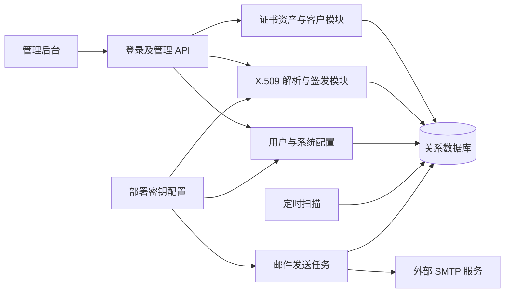

# 证书管理系统 MVP 设计文档

> P1 性能增量（2026-11-16）：证书管理列表改为服务端分页，新增接口见本文末尾“P1 性能实现”。原全量接口仍兼容，其他历史描述按已标注的最新增量理解。

> 当前更新（2026-11-16）：第17节记录已实现的证书自动选取、五列执行计划、API及V11/V12迁移，并覆盖与本轮冲突的旧描述。其余早期方案与现状的差异仍参见[核对基线](requirements-design-review-2026-11-14.md)，尤其数据库会话、路由、分页和错误结构，不将历史建议当作已实现功能。

版本：0.5（P2性能实现增补）

更新日期：2026-11-16

依据：[需求文档](requirements.md) v1.5

界面参考：`doc/prototype.html`

## 1. 设计目标与边界

面向内部管理员，提供自有及客户证书资产管理、三层签发、客户维护、SMTP配置和到期邮件通知。所有用户当前均为管理员，预留授权扩展。新旧证书独立并列，不建立版本或替换关系，按到期时间升序展示。

技术选型已确认：Spring Boot 后端、Vue 3 前端、H2 数据库。不做前后端独立部署，Vue 3 构建产物由 Spring Boot 提供，同源访问、统一打包部署。明确需求遵循需求文档；本文自行补充的实现方案标注为“设计建议”。文档评审通过后再形成实施计划，不在本轮编写产品代码。

服务器管理与证书同步流程已实现，通用设计见 [服务器与同步设计](server-sync-design.md)，本轮增量见第17节。自动签发续期、客户登录、角色配置、证书版本管理和独立证书生成菜单仍不在范围；按规则选用已导入的新证书不等于自动签发续期。SFTP上传不代表远端应用自动加载证书，完整链也不等于外部系统已信任或撤销状态已检查。

## 2. 架构方案与取舍

| 方案 | 价值 | 代价 |
| --- | --- | --- |
| 模块化单体，前后端通过 API 交互 | 事务容易保证，单套后端即可部署，适合内部 MVP | 后端和调度共享部署资源 |
| 后端模板渲染单体 | 工程及部署组件少 | 复杂多文件表单、展开列表的交互维护不如组件化前端方便 |
| 微服务，签发和通知独立部署 | 可独立隔离扩容 | 跨服务事务、密钥分发及运维成本较高 |

**已选定模块化单体，统一部署。** 后端 Spring Boot、前端 Vue 3、数据库 H2。Vue 通过内部 API 访问后端，API 分层是代码组织方式，不形成独立部署的前端服务。前端组件库、Java/Spring Boot 版本、X.509 库和依赖版本在实施计划中确定。H2 保存结构化数据、规范化证书及加密秘密。MVP 无需 Redis、消息中间件或外部对象存储。



扫描和邮件任务初期与后端同进程，使用数据库任务锁防止并发重复执行；扩容后仍保持同一任务协议。

## 3. 模块与页面设计

### 3.1 页面职责

| 路由建议 | 菜单 | 主要交互 |
| --- | --- | --- |
| `/certificates/own` | 自有证书 | 根、中间、叶子三个独立表格，各自分页、创建，页面统一导入 |
| `/certificates/customer` | 客户证书 | 仅终端证书，点击名称懒加载展开上级链 |
| `/customers` | 客户管理 | 名称、描述、操作，新增及编辑 |
| `/sync` | 证书同步 | 业务组件与Shell步骤、五列执行计划、列表立即执行及执行记录 |
| `/servers` | 服务器管理 | SFTP/HTTP/SSH连接与凭据、启停及连通性测试 |
| `/system/users` | 系统管理 / 用户管理 | 账号维护 |
| `/system/smtp` | 系统管理 / SMTP配置 | SMTP 保存及测试 |
| `/system/notifications` | 系统管理 / 通知服务 | 规则及发送记录 |

自有证书三表列：名称 / 用途 / 签发者 / 到期时间 / 状态 / 操作。客户证书列：证书名称 / 客户 / 用途 / 层数 / 到期时间 / 状态 / 操作。类型和私钥信息保留在详情，不额外增加列表列。

列表排序建议为 `not_after ASC, asset_id ASC`，同到期时间稳定排序，已过期记录不自动隐藏。时间以 UTC 存储，界面按配置时区显示。状态在查询时计算，避免每日更新造成过期状态延迟。

### 3.2 表单与状态

导入：选择格式 → 上传材料 → 验证 → 预览 → 确认保存。客户导入也可由“保存”触发验证和提交，不要求用户提前创建客户。失败留在表单展示字段级原因；修改文件后清除旧验证结果。

所属客户为可编辑下拉框，搜索已有名称也可自由输入；不设单独新增按钮。生成表单的 CN 是主体字段，不另设证书名称。客户管理中的描述可为空。

## 4. 数据模型

字段、H2约束及索引的详细设计见 [数据库表设计](database-design.md)，建表草案为 [V1__initial_schema.sql](sql/V1__initial_schema.sql)。该文件细化本节概念模型：使用 app_users/app_sessions 等实际表名，通知节点与收件人拆表，import_requests 泛化为 operation_requests。

设计建议将不可变公钥材料与业务归属拆开，避免 CN 重名和共享 CA 导致重复，同时隔离客户资产与自有私钥。

| 表 / 实体 | 主要字段 | 约束及用途 |
| --- | --- | --- |
| `users` | id、username、password_hash、enabled、auth_epoch、时间字段 | username 唯一，auth_epoch 用于会话失效 |
| `sessions` | id_hash、user_id、auth_epoch、expires_at | 仅保存会话令牌哈希，停用或重置密码使会话失效 |
| `roles`、`user_roles` | 角色标识、用户关联 | 预留模型，MVP 仅 ADMIN；不开放角色页面 |
| `customers` | id、name、name_key、description、时间字段 | name_key 唯一，实现并发复用 |
| `certificate_materials` | id、sha256、der、cn、subject、issuer、serial、not_before、not_after、算法、SAN、CA扩展、SKI、AKI | sha256 唯一，公钥材料不可变，无私钥字段 |
| `certificate_assets` | id、material_id、owner、customer_id、purpose、kind、depth、remark、业务描述、时间字段 | owner 为 OWN/CUSTOMER；客户资产必须有关联客户 |
| `asset_chain_nodes` | asset_id、position、material_id | 保存确定链，position 从根的 1 开始；组合唯一 |
| `private_keys` | own_asset_id、ciphertext、nonce、key_id、算法、public_key_hash | 仅关联 OWN 资产，禁止 CUSTOMER；一个资产至多一个私钥 |
| `smtp_config` | host、port、tls_mode、username、credential密文、sender、config_revision | MVP 单配置；revision 仅用于并发修改控制 |
| `notification_policy` | enabled、timezone、scan_time、threshold_days、recipients、时间字段 | MVP 单全局策略 |
| `notification_deliveries` | id、asset_id、threshold、recipient、not_after_snapshot、status、attempts、next_attempt_at、lease_until、message_id、error | 唯一去重键，发送任务及结果 |
| `audit_events` | actor、action、target、result、request_id、time | 无秘密内容，记录关键操作 |
| `import_requests` | request_id、actor、payload_digest、asset_id、result | 保存提交幂等结果，不存上传密码 |

`certificate_assets` 唯一性建议：OWN 按 material_id 去重，CUSTOMER 按 customer_id + material_id 去重。一个资产一个用途，不因用途变化复制证书；这是待确认默认，不改变不同指纹的新旧证书并列规则。跨客户可共享同一公钥材料，业务资产、用途和提醒独立。

根及中间材料在客户链中仅作为 chain_nodes，不生成客户主列表资产。自有导入为根、中间及叶子建立 OWN 资产并按指纹复用。终端密钥挂在对应叶子资产；仅导入公钥的 CA 不获得签发资格。

主要索引：材料指纹；客户 name_key；资产 owner/kind；客户资产 customer_id；材料 not_after；通知 status/next_attempt_at 和去重键。外键阻止孤立关联，业务事务同时校验 owner 和私钥约束。

不建立 certificate_versions、previous_certificate_id、replacement_id、使用中或已替换状态。配置并发修订号与证书版本无关。

## 5. 证书解析与校验

### 5.1 格式入口

| 归属 | 格式 | 上传内容 |
| --- | --- | --- |
| 自有 | CER/DER/CRT/PEM | 多行证书 + 一个终端私钥，可填解密密码 |
| 自有 | P7B/P7C | 证书库 + 一个终端私钥，可填解密密码 |
| 自有 | P12/PFX | 一个含链及私钥的库，可填库密码 |
| 客户 | CER/DER/CRT/PEM | 多行公钥证书，无私钥输入 |
| 客户 | P7B/P7C | 一个公钥证书库，无私钥输入 |

解析以实际内容为准，支持 DER 或 PEM 编码的对应容器。客户入口拒绝含私钥材料及 PKCS#12 容器，即使伪装扩展名。上传大小、文件数、证书数与解析耗时须设上限，具体数值留实施阶段确定。

### 5.2 验证算法

1. 解析容器和全部证书，解密私钥（仅自有），规范化为 DER，按 SHA-256 去掉材料重复项。
2. 每个证书提取 Subject CN、Issuer、扩展、时间、公钥等。CN 异常按第 13 节待确认默认处理。
3. 按 Issuer/Subject、AKI/SKI 找候选签发者，再验证密码学签名；不能仅按字符串匹配认定链关系。
4. 验证 Basic Constraints、适用的 Key Usage、路径长度约束、关键扩展及循环，识别根与终端。根必须为 CA 且自签名验证成功。
5. 构造唯一目标终端到根的完整链。缺失、循环、多终端、多条无法消歧的链或不属于目标链的额外材料拒绝并解释。
6. 自有导入要求恰好一个终端私钥，通过派生公钥与终端 SubjectPublicKeyInfo 比较验证匹配；客户不读取或保存私钥。
7. 输出链、类型、层数、CN、指纹和时间检查结果；时间失败是否允许资产登记按待确认策略执行。

不访问 AIA 自动下载上级，不因服务器操作系统已有信任根而忽略提交链缺失。MVP 不执行在线 OCSP/CRL 检查，详情明确“未检查撤销状态”。完整性验证与有效期状态分开，避免将过期误认为签名不匹配。

### 5.3 预览与确认的一致性

设计建议预览接口返回解析摘要及摘要签名，不持久化明文材料。确认时重新提交原材料、密码、预览摘要及幂等键，服务器重新解析和校验并核对摘要，不能信任前端提交的 CN、链和匹配结果。材料在请求内存处理，请求结束释放，不记录请求体或密码，不持久化未完成上传。

## 6. 保存事务与客户自动创建

验证成功后进入短事务：

1. 对客户名称执行 trim；建议 name_key 再做 Unicode 规范化及大小写折叠，原展示名称保留。
2. 按 name_key 原子插入或获取客户，描述默认为空；不覆盖既有名称和描述。
3. 依指纹插入或复用公钥材料，创建或获取业务资产及链节点。
4. 自有私钥加密后写入，验证已有私钥公钥一致，不用新密码等属性覆盖原秘密。
5. 保存提交幂等结果与审计信息，提交事务；失败整体回滚，包括新建客户。

并发唯一冲突后读取已有记录，不能通过“先查询再无条件插入”实现唯一性。重复导入同一资产返回已有记录及“已存在”，不覆盖用途。客户改名以客户 id 关联，不修改证书名称。客户管理 MVP 无删除接口。

提交幂等键按操作类型、用户及 request_id 建唯一约束，payload_digest 包含材料指纹、归属、客户及用途，不包含明文密码。同一键不同摘要返回 409；同一键并发请求只允许一个事务成功，其余返回相同结果。签发也使用该协议，唯一冲突产生的未保存密钥立即释放。材料表只保存公钥信息，客户链读取接口不联查或返回自有私钥；共享材料不代表共享资产权限。

签发请求的摘要基于规范化输入参数（主体、上级、用途、算法、有效期及 SAN），不得基于随机生成的密钥、序列号或证书结果，以保证相同请求重试可识别。

## 7. 三层签发设计

- 根：生成新密钥，Subject=Issuer，自签名，CA=true，配置证书签发 Key Usage；设计建议 pathLen=1。
- 中间：上级仅可选择根，有效且有私钥，CA=true，建议 pathLen=0。
- 叶子：上级仅可选择中间，CA=false；HTTPS 校验 SAN，AS2/通用扩展按确认的签发模板设置。
- 私钥在后端生成，使用成熟库签名，不把用户字段拼接为命令执行。
- 序列号采用符合库要求的随机正整数，并约束同签发者下唯一。
- 签发前校验整条祖先链有效、CA扩展和私钥匹配；子证书 not_before/not_after 必须在签发者区间内，前端限制不能替代服务端验证。
- 密钥生成及签名在事务外完成；事务内复核上级仍有效及材料未变化，再保存资产、密钥、链和幂等结果，失败释放未保存材料。
- 通过签发策略枚举限制三层，算法及默认年限待选定，不直接采用原型示例。

## 8. API 草案

所有接口以 `/api/v1` 开头，除登录外要求有效会话及 ADMIN 授权。导入使用 multipart，JSON 不返回私钥明文。

| 方法与路径 | 功能 |
| --- | --- |
| POST `/auth/login`；POST `/auth/logout`；GET `/auth/me` | 登录、退出、当前用户 |
| PUT `/auth/password` | 修改本人密码 |
| GET/POST `/users`；PATCH `/users/{id}`；POST `/users/{id}/reset-password` | 用户维护 |
| GET/POST `/customers`；PATCH `/customers/{id}` | 客户分页搜索、新增、编辑 |
| GET `/certificates?owner=&kind=&customerId=&purpose=&status=&q=&page=` | 列表，固定默认到期升序 |
| GET `/certificates/{id}`；GET `/certificates/{id}/chain` | 详情和完整链 |
| PATCH `/certificates/{id}` | 更新用途、备注等白名单字段，不允许修改 CN、材料或客户归属 |
| POST `/imports/preview`；POST `/imports/commit` | 预览验证、重新验证并原子保存 |
| GET `/issuers?childKind=` | 查询符合条件且有私钥的签发者 |
| POST `/certificates/issue` | kind、issuerId、subject、用途、算法、有效期及 SAN；根无 issuerId |
| POST `/certificates/{id}/export` | 按确认格式导出；私钥导出要求额外明确操作和密码 |
| GET/PUT `/system/smtp`；POST `/system/smtp/test` | 脱敏读取、保存、测试 |
| GET/PUT `/system/notifications` | 通知策略 |
| GET `/notification-deliveries`；POST `/notification-deliveries/{id}/retry` | 发送记录及失败重试 |

列表返回 items、total、page、pageSize；证书 DTO 返回 id、CN、客户、用途、kind、depth、issuerName、notBefore、notAfter、status。测试邮件请求明确接收地址，不从客户描述推断邮箱。

统一错误包含 code、message、fieldErrors、requestId。示例代码：CHAIN_INCOMPLETE、CHAIN_AMBIGUOUS、KEY_MISMATCH、PRIVATE_KEY_FORBIDDEN、CONTAINER_NOT_ALLOWED、DECRYPT_FAILED、CN_INVALID、ISSUER_UNAVAILABLE、CUSTOMER_NAME_REQUIRED。鉴权失败使用 401/403，输入及解析失败使用 422，唯一冲突 409；错误不回显秘密。

## 9. SMTP 与通知任务

### 9.1 配置

SMTP 独立保存 host、port、STARTTLS/TLS、username、加密凭据及 sender。读接口只返回 credentialConfigured，不返回密码；更新显式区分保留、替换和清空。测试使用当前已保存配置，记录脱敏失败信息；连接和发送均有超时，不关闭服务器证书校验。

通知服务保存 enabled、recipients、thresholdDays、scanTime、timezone。服务器检查邮箱、节点非负及重复、时区和时间格式，SMTP 未就绪时明确阻止发送并提示。

### 9.2 调度与去重

设计建议按策略时区的本地日期计算剩余日数，界面状态仍按精确 UTC 时间判断。每日节点到达时创建发送任务；任务唯一键为 `(asset_id, not_after_snapshot, threshold_days, normalized_recipient)`。更改扫描时间或重启不重发已成功节点。

数据库事务创建 PENDING 任务后由发送器执行：PENDING → SENDING → SENT；失败进入 RETRY_WAIT，超出次数进入 FAILED。使用租约及原子领取避免多个工作线程并发发送，重启后回收过期租约。重试沿用同一任务、Message-ID 和去重键，已成功任务不可手动重试。

SMTP 接收成功与本地标记 SENT 无法构成原子事务；若发送成功后进程崩溃或回执超时，重试仍可能重复邮件。本设计保证成功记录去重和避免并行重复，不承诺 SMTP 严格恰好一次投递。记录此类不确定结果便于排查。

候选策略：提前 30/14/7/1 天，Asia/Shanghai，09:00；均为建议。CA范围、历史过期证书和停机补发待确认后实现对应策略；不默认对历史旧证书无限重复提醒。

## 10. 安全、部署与运维

- Spring Boot 提供静态前端与 API，H2 文件模式持久化；可选反向代理仅用于入口及 HTTPS 终止，不独立部署前端。
- 私钥及 SMTP秘密使用带认证加密，如 AES-GCM，每条独立随机 nonce，保存 key_id；密钥从受保护部署秘密读取，不放数据库或仓库。轮换支持按 key_id 解密旧记录再重新加密。
- 用户密码采用成熟密码哈希，登录限流；会话使用 HttpOnly、Secure、SameSite Cookie，写请求具备 CSRF 防护。
- 所有账号走统一授权检查，当前只放行 ADMIN；最后一个启用管理员的停用检查需事务锁，避免并发清空管理员。
- 私钥导出受专门接口控制，不混入普通详情；格式和导出密码未确认前不开放无保护私钥下载。
- 审计记录用户、对象、动作、结果和时间，不记录原材料、认证头、私钥、密码或含秘密请求体。
- 数据迁移由版本化脚本执行。备份包括数据库及独立密钥备份；恢复后验证私钥解密、链关联、策略及任务去重。
- 提供健康检查、任务扫描时间和脱敏发送失败日志。部署规模、备份周期及日志保留期限留实施阶段确定。

## 11. 验证设计

| 验证组 | 必测场景 |
| --- | --- |
| 解析与链 | 五类入口；乱序、缺根、循环、错误签名、错误 CA 约束、多终端、私钥伪装、错误密码 |
| 密钥隔离 | 终端匹配/不匹配；客户私钥拒绝；公钥 CA 不可签发；密文可解密且日志无秘密 |
| 签发 | 根自签、中间选根、叶子选中间；过期及无密钥上级拒绝；有效期越界拒绝 |
| 客户事务 | 名称选择/直接输入；客户并发复用；无效链不创建客户；改名关联不变 |
| 列表 | 三表字段、客户仅叶子、展开链、CN重名、到期升序、新旧独立并列 |
| 通知 | 时区边界、节点去重、并发领取、失败重试、重启租约恢复、配置修改不重复 |
| 认证 | 停用会话失效、密码重置、最后管理员并发保护、未登录访问拒绝 |
| 恢复 | 迁移、备份恢复、加密材料可读、发送任务不丢失 |

采用真实生成的测试证书及容器作为固定测试材料，不使用生产秘密。SMTP 使用本地测试接收服务验证实际邮件，原型消息不作为验证证据。

## 12. 需求追踪

| 需求验收 | 设计章节 |
| --- | --- |
| AC-01、AC-02 | 3 |
| AC-03 | 4、5 |
| AC-04 | 7 |
| AC-05、AC-06、AC-07 | 5、6 |
| AC-08、AC-10 | 6、8 |
| AC-09 | 3、4、5 |
| AC-11 | 4、8、10 |
| AC-12 | 9 |
| AC-13 | 10、11 |
| AC-14 | 1、3、4 |

## 13. 设计建议与待定决策

以下均为设计者建议，不标记为用户已确认：

1. 已确认 Spring Boot + Vue 3 + H2 模块化单体，前后端统一打包部署；运行平台及具体版本待定。
2. 用途单选；每个客户资产属于一个客户；公钥材料跨归属复用，私钥严格隔离。相同指纹在同一归属及客户下复用。
3. 客户名称使用 trim、Unicode规范化和大小写折叠生成唯一键；需要确认名称比较习惯。
4. 缺失或多个 CN 默认拒绝导入并说明原因，不用 SAN、文件名或客户名替代。
5. 导入链允许多个中间层时统一进中间表，depth 记录真实层数；生成仍固定三层。是否接受短链、长链须确认后启用。
6. 已过期但签名完整的材料建议允许登记并标记过期，不作为签发者；不因此绕过链完整验证。
7. 导出格式、CA 私钥导出、补充 CA 私钥、算法与 AS2/HTTPS 扩展模板需确定。
8. 通知节点、CA范围、共享 CA 去重、过期提醒、补发及重试参数需确定。
9. 证书删除、归档、数据保留及密码会话策略待定。初始管理员已确认，见第 15 节。

上述决策可在设计评审中调整。选定架构并确认关键边界后，将本文作为实施计划输入。

## 15. 统一部署、H2 与初始账号（2026-11-08 确认）

### 15.1 工程与打包

- 后端使用 Spring Boot，前端使用 Vue 3；单仓库管理，建议后端与 `frontend/` 目录组织。
- 构建流程先执行 Vue 生产构建，将产物纳入 Spring Boot classpath 静态资源，再打包为一个可执行 JAR。
- 运行时只启动 Spring Boot，后端提供 HTML、JS、CSS 和 `/api/v1`，不要求单独运行 Node 或前端服务器。
- 采用同源会话 Cookie；仍保留后端统一认证和 CSRF 防护，不开放跨域作为正常访问方式。
- 建议使用 Vue Router history 模式，后端只将合法页面路由回退至 index.html；API、缺失静态文件和未授权请求不可被回退规则吞掉。
- 开发时可使用 Vite 热更新代理，属于开发工具，不改变生产单体部署方式；如无需热更新，直接使用统一构建产物。

### 15.2 H2 持久化

- 使用 H2 文件模式而非内存模式，数据库文件位于 JAR 外部可配置的数据目录，重启及重新打包不丢失数据。
- MVP 按单应用实例使用嵌入式 H2，不使用自动混合模式或将同一数据库文件挂载给多个实例。
- JDBC URL 由部署配置提供，例如 `jdbc:h2:file:./data/certificate-manage`；该相对路径以启动目录为基准，部署建议配置绝对路径。
- 表结构迁移使用版本化迁移脚本，不使用每次启动删除重建表的模式；迁移工具与 H2 版本兼容性在实施时验证。
- 生产默认不开放 H2 Web Console，数据库凭据通过部署配置提供，与应用用户账号分开。
- 备份采用停机一致性备份或 H2 支持的一致性备份机制，不在写入时直接复制数据库文件；解密密钥独立备份。
- 原架构中并发领取和租约逻辑保留，用于同实例工作线程和重启恢复；本 MVP 不以 H2 文件实现多实例扩容。

### 15.3 初始管理员

- 首次初始化创建用户名 `admin`、初始密码 `123456`，启用并授予 ADMIN。
- 仅在数据库尚未完成首次账号初始化时执行，事务中创建账号及初始化标识，并以用户名唯一约束防止重复。
- 密码使用专用密码哈希保存；后续重启不得重置密码、重新启用已停用账号或覆盖已有用户。
- 原有数据库已有 admin 时保留现有账号及密码，不强制重建。
- 支持用户登录后修改密码；初始明文密码不写入日志。是否强制首次修改尚未确定，本轮不新增强制修改流程。

## 14. 文档检查记录

2026-11-07 完成独立可实施性检查，重点核对提交幂等、客户链材料与私钥隔离、签发事务一致性；未发现超出已列待定事项的重大阻塞。检查补充了签发幂等摘要必须来自请求参数的规则。该检查属于设计审阅，不代表代码、运行结果或安全测试已完成。


## 16. 工程目录与组织约定

采用单仓库、单 Maven 后端工程及独立前端源码目录。前端源码与后端代码各自组织，生产构建仍为一个 Spring Boot JAR，不改变统一部署要求。以下为目标目录设计，不表示当前已生成工程。

```text
certificateManage/
├── pom.xml                           # 后端依赖及统一构建入口
├── mvnw / mvnw.cmd                   # Maven Wrapper
├── .mvn/wrapper/
├── .gitignore
├── .editorconfig
├── README.md                         # 启动、构建、配置与部署说明
├── doc/
│   ├── requirements.md
│   ├── design.md
│   └── prototype.html
├── src/
│   ├── main/
│   │   ├── java/<base-package>/
│   │   │   ├── CertificateManageApplication.java
│   │   │   ├── config/               # 安全、Web、调度及类型化配置
│   │   │   ├── common/
│   │   │   │   ├── error/            # 错误码、异常及统一异常处理
│   │   │   │   └── web/              # 分页等通用 HTTP 约定
│   │   │   ├── auth/                 # 登录、会话和授权入口
│   │   │   ├── user/                 # 用户管理
│   │   │   ├── customer/             # 客户管理
│   │   │   ├── certificate/          # 资产、链、导入、签发及导出
│   │   │   ├── smtp/                 # SMTP 配置和邮件传输适配
│   │   │   ├── notification/         # 策略、扫描和发送任务
│   │   │   └── audit/                # 操作审计
│   │   └── resources/
│   │       ├── application.yml       # 非敏感默认配置
│   │       ├── application-dev.yml   # 开发配置
│   │       ├── application-prod.yml  # 生产配置，秘密引用外部配置
│   │       ├── db/migration/         # 版本化数据库迁移
│   │       └── static/               # 仅构建时承接 Vue 产物
│   └── test/
│       ├── java/<base-package>/      # 与业务包对应的测试
│       └── resources/
│           ├── application-test.yml
│           └── certificates/        # 非生产测试证书及容器
├── frontend/
│   ├── package.json
│   ├── package-lock.json            # 固定 npm 依赖，构建使用 npm ci
│   ├── index.html
│   ├── vite.config.ts
│   ├── tsconfig.json
│   ├── env.d.ts
│   ├── .env.example                 # 无秘密的环境变量示例
│   ├── public/                      # 原样复制的公开静态资源
│   ├── src/
│   │   ├── main.ts
│   │   ├── App.vue
│   │   ├── router/                  # 页面路由及导航守卫
│   │   ├── layouts/                 # 后台侧栏、顶栏、内容区
│   │   ├── views/
│   │   │   ├── auth/
│   │   │   ├── certificates/
│   │   │   │   ├── own/
│   │   │   │   ├── customer/
│   │   │   │   └── components/      # 证书链、导入及签发表单
│   │   │   ├── customers/
│   │   │   └── system/
│   │   │       ├── users/
│   │   │       ├── smtp/
│   │   │       └── notifications/
│   │   ├── api/                     # HTTP 客户端及按业务拆分的接口
│   │   ├── stores/                  # 登录态等必要跨页面状态
│   │   ├── composables/             # 可复用组合式逻辑
│   │   ├── components/              # 跨业务通用组件
│   │   ├── types/                   # DTO 和共享类型
│   │   ├── assets/                  # 参与构建的资源
│   │   ├── styles/                  # 主题及全局基础样式
│   │   └── utils/                   # 日期等少量纯函数
│   └── tests/                       # 页面集成测试及端到端测试
├── deploy/
│   ├── application.example.yml      # 外置配置模板
│   └── README.md                    # 单实例部署与备份恢复
├── data/                            # H2 运行数据，不入库
├── logs/                            # 可选运行日志，不入库
└── target/                          # Maven 构建产物，不入库
```

### 16.1 后端模块内部结构

业务模块按需要使用 `controller/`、`dto/`、`service/`、`domain/`、`repository/`，避免所有业务集中在全局 controller/service 目录。证书模块额外按职责设置 `importing/`、`issuing/`、`chain/` 和 `crypto/`，保持接口清晰；不为不存在的功能创建空包。

- Controller 负责协议、输入约束及 DTO 转换，不处理证书密码学及数据库事务。
- Service 负责用例编排、授权及事务边界，Repository 只负责持久化访问。
- Domain 保存领域类型及业务约束，实体不直接作为 HTTP 响应。
- 密码学操作封装为可独立测试的组件，不直接耦合 Controller；密钥解密入口集中管理。
- 通用代码仅在确实跨模块共享时进入 common，不设无边界的工具类集合。
- 包名采用小写反向域名，实际组织域名实施时确定；路径中的 `<base-package>` 是占位符。

### 16.2 前端组织与依赖

设计建议使用 Vue 3 Composition API、`script setup` 和 TypeScript；具体组件库及状态库版本实施前确定。

- views 对应路由页面，页面专属组件放在页面附近，真正跨业务组件放入 components。
- 所有后端请求经过 api 客户端，统一处理会话失效、CSRF、错误结构和请求取消；组件不直接散布请求逻辑。
- 路由菜单包含自有证书、客户证书、客户管理，以及系统管理下的用户管理、SMTP配置、通知服务。
- 筛选、分页及表单状态优先保留在页面；只有登录用户等跨页面状态进入 stores。
- TypeScript DTO 与后端接口保持一致；前端状态和 CN 展示不能替代后端校验。
- 单元或组件测试可使用邻近 `*.spec.ts` 文件，跨页流程在 tests 中集中验证。
- `.env` 中不放数据库密码、SMTP秘密或私钥，前端环境变量均视为公开信息。

### 16.3 统一构建与仓库卫生

- 统一生产构建由 Maven 调用前端构建：npm ci → Vue/Vite build → 将 dist 内容复制到 Maven 的生成资源目录 → 打包进入 JAR 的 static。
- 建议复制目标为 `target/generated-resources/static/` 并纳入资源处理，不反复改写或提交源码目录中的 static 产物。
- frontend/dist、frontend/node_modules、target、data、logs、私钥、真实证书上传材料和含秘密配置均加入忽略规则。
- 测试证书仅使用明确标记的虚构材料；测试私钥不得与运行环境混用。
- npm 与 Maven 版本在构建工具配置中固定；CI 与本地使用同一 Maven Wrapper 入口，构建前清理生成资源以避免旧页面残留。
- 不创建独立前端生产部署目录或生产 Node 服务，部署物为可执行 JAR、外置配置及持久化数据目录。
# 自有证书删除实现补充

`DELETE /api/v1/certificates/{id}` 仅接受自有资产，由管理员调用，受现有会话及CSRF保护。服务与签发/导入共享同步锁，在事务中校验完整链和签发引用，拦截仍被引用的证书。成功后写入 `deleted_at` 和 `CERTIFICATE_DELETE` 审计事件。页面确认后调用接口，失败显示引用名称及ID，成功刷新三个表格。删除为逻辑删除，保留历史及加密材料；通知扫描和工作队列排除已删除资产。

# 证书Subject字段补充

签发接口新增可选字符串参数 `country`、`state`、`locality`、`organization`、`organizationalUnit`，分别映射C/ST/L/O/OU。使用X500NameBuilder逐字段编码，安全处理逗号等DN特殊字符；缺省参数保持兼容。现有 `subject_dn` 存储完整Subject，无需新增数据库列，详情和导出均保留这些字段。

## 17. 证书自动选取与五列执行计划（2026-11-16）

本节对应需求第16节，描述当前实现；执行计划交互、字段及示例见 [专项设计](schedule-business-design.md)。

### 17.1 证书解析与入队快照

`WorkflowService.enqueue` 在事务及同步锁内调用 `WorkflowValidator.prepare(..., true)`；`BusinessComponents.prepare` 每次重新解析候选，然后创建执行记录、冻结流程与证书引用。后台执行使用该次快照，后续导入不会替换已入队的材料。

IS keyStore 自动模式保留 `selectionMode=AUTO` 和基准 `certificateId`。服务端从基准资产对应的持久化材料读取实际 `common_name`，并验证其为含私钥的自有叶子；允许从已软删除基准的保留材料读取 CN。按以下顺序查询与校验：

1. 限定 `owner_type=OWN`、`certificate_kind=LEAF`、CN精确相等、已启用、未归档/删除，并存在对应私钥；不按用途另行过滤。
2. 按材料 `not_after DESC, asset id DESC` 排序，逐条检查完整链当前有效期，取首个可用候选。
3. 无可用链时拒绝入队；有候选时冻结资产、链节点与私钥引用，生成 keyStore。指定模式 `MANUAL` 保留固定资产引用及有效性检查。

`certificateCn` 是服务端返回的预览辅助字段；前端在原基准不在普通列表时用它展示匹配结果，更换基准立即清除旧值。服务端不以客户端提交的 CN 作为权威匹配依据。基准失效不阻止选新链，但实际候选仍须满足全部可用条件。

客户业务组件自动模式使用客户ID、用途确定候选，按终端到期降序与资产ID降序选取整链有效者。指定链及 truststore 部分节点选择固定引用。旧通用证书库制作条目仍按指定资产执行，不扩大本轮自动匹配范围。

### 17.2 五列参数与执行时间

`ScheduleEditor.vue` 提供月份、日期、星期、小时、分钟五列独立滚动勾选列表；每列可多选并一键设为“不限”。新任务采用 `frequency=CALENDAR`，默认每天02:00、`Asia/Shanghai`，页面不提供手动/定时方式切换。

`SchedulePlan.normalize` 统一校验、去重排序、生成中文摘要及调度字段。参数为 `months`（1–12）、`monthDays`（1–31）、`weekdays`（1–7，周一至周日）、`hours`（0–23）、`minutes`（0–59）和 `timezone`。空列表、缺省或选择完整范围归一为“不限”。同列取并集，不同列取交集；日期与星期同时指定时均须满足。

后台保留 Spring 六字段 Cron，秒固定0。日期、月份、星期用精确枚举，仅小时和分钟的完整等距选择可压缩为步长。不存在的日期跳过；整个组合没有未来触发时间时保存及预览均拒绝。时间计算由同一服务端解析器按计划时区完成，不使用浏览器本地时区推测。

### 17.3 保存与兼容

五列计划的服务端保存逻辑从 `state` 派生调度状态：`READY` 启用，`DRAFT` 关闭但保留参数；同时保存规范化 `schedule_json`、派生的 `cron`/`timezone` 及 `next_fire_at`。不接受冗余表达式或前端摘要覆盖结构化计划；原修订号冲突检查及事务边界保留。

前端在提交时按任务状态设置兼容 `scheduleEnabled` 字段；旧频率及旧API请求继续兼容原字段。迁移和查询不批量启用旧任务，页面打开与预览不写任务。常用旧计划无损转换为五列；月末、秒级及其他复杂规则以 `CUSTOM` 保留原文，在高级设置中编辑。旧规则显示秒数，避免三次触发被显示为同一分钟。

### 17.4 预览API与界面状态

`POST /api/v1/sync-tasks/schedule-preview` 接收计划对象，返回规范化 `schedule`、`cron`、`timezone`、`summary` 和 `nextTimes`（最近三次）。该接口受会话、ADMIN及CSRF保护，不要求先保存任务，也不校验证书或步骤完整性，不创建任务或执行实例。

前端对修改做300毫秒防抖，并立即使旧预览失效。请求序号阻止旧响应覆盖新选择；错误展示业务原因且清除旧成功结果，组件卸载取消等待请求的回写。草稿也可预览，明确标记尚未启用。实时预览是编辑页唯一的计划时间来源，保存校验块不重复展示过期时间。

列表展示服务端中文 `scheduleSummary` 及按计划时区格式化的下次时间；历史未启用计划附加“未启用”。手动执行使用列表按钮，仍遵守就绪校验、幂等与同任务互斥。

### 17.5 迁移、运行与验证

V11新增 `sync_tasks.schedule_json CLOB`；V12扩展 `cron` 为 `VARCHAR(500)`，避免多列多选被截断。不新增表，不修改已发布迁移。原字段仍供调度器及兼容API使用，详情/列表由 `WorkflowQueries` 返回计划及摘要。字段说明见 [数据库设计](database-design.md)。

调度到期时先推进未来时间再尝试单次入队，冲突或不可用引用留下失败原因。计划触发不是实际开始或成功承诺；失败不自动重试。停机不逐次补跑全部遗漏，恢复时可能处理一次已到期触发；重启中断实例不自动重放远端操作。

本轮验证包括同CN换证及快照冻结、基准软删除、五列交集及跨月日期、星期组合、旧规则兼容、时区/夏令时、权限与只读预览、V10起的迁移、过期响应隔离。最终后端116项、前端31项测试通过，已按项目约定重新打包重启并检查首页、API及实际页面；该结果不替代外部服务器业务联调。记录见 [五列计划实施记录](../docs/superpowers/plans/2026-11-16-calendar-schedule.md)。

## 18. 标准部署包与维护脚本（2026-11-16）

`production`构建在Spring Boot重打包之后执行Maven Assembly，生成`certificate-manage-0.1.0-dist.zip`及展开目录，包内根目录为`certificateManage`。`lib/certificate-manage.jar`仍是包含前端和第三方依赖的可执行JAR；`config/application.yml`来自应用默认配置，`config/jvm.options`逐行保存JVM参数；`bin`提供Windows BAT与Linux SH入口；logs/data/run仅包含目录占位，不拷贝运行文件。

BAT使用系统自带Windows PowerShell实现精确进程检查与后台启动，控制逻辑内嵌于`service.bat`，发布包不增加第三种维护入口。Linux采用Bash、curl、flock及/proc核对精确的`-jar`参数。两套脚本解析自身路径并固定工作目录为项目根目录，以外置config目录作为Spring Boot附加配置位置，保留PORT、数据库及主密钥等环境变量覆盖方式。

维护锁避免同时执行相冲突的管理动作；启动检查重复进程及探测地址占用，记录PID并等待首页/CSRF API就绪；状态区分健康运行、停止与异常。停止必须核对PID的Java及JAR身份，PID缺失时按精确JAR路径找回。Linux发送TERM并等待，超时保留PID、不默认强杀；Windows采用系统进程终止，不宣称具有相同的优雅关闭语义。

默认应用日志写`logs/certificate-manage.log`，由Spring Boot/Logback按10MB、30天、总量1GB滚动。启动控制台输出单独写logs；数据库审计存储保持不变。运行时只安装lib/config/bin及说明文件，升级先停机备份原data与主密钥，不以新包覆盖data、logs或未经合并的配置。验收使用含空格的临时解压目录、独立端口与独立测试数据库验证真实脚本生命周期，不使用生产数据库做发布包启动测试。详见 [部署维护说明](../deploy/README.md)。

## 19. P1 性能实现（2026-11-16）

### 19.1 证书查询

`CertificateService` 在普通、归档及单条详情结果集打开前读取一次预警天数，并捕获请求时间供全部行映射使用。mapper不再执行SQL，避免N+1和外层查询持有连接时获取第二连接。旧全量接口的数组响应及详情字段继续兼容。

新增 `GET /api/v1/certificates/page` 与 `GET /api/v1/certificates/archived/page`，由独立 `CertificatePageQuery` 完成筛选、计数和分页，响应 `{items,total,page,size}`。普通查询owner默认OWN；归档owner可空。可选kind、purpose、query、status；page默认1、范围1～1000000，size默认20、范围1～100，非法业务参数沿用422。

query最长200字，对CN与客户组合做不区分大小写的包含查询，`!/%/_`转义为字面值。状态使用同一时刻和预警天数，未来生效优先、截止时刻含在过期中、到期恰为预警阈值时仍有效。SQL条件与展示共用边界，固定时钟测试覆盖这些时刻。普通、归档和已删除范围隔离，分页按到期时间及ID升序。

分页仅投影表格摘要，Subject、SAN、指纹等详情按需取得。无新增表或迁移，旧组件继续用原接口；同步证书选项的远程搜索留到后续P2。

### 19.2 前端和资源

自有三表、客户与归档页面使用服务端每页20条分页。共享分页辅助对每张表维护独立页码、总数、loading和请求代际；搜索300ms防抖，筛选立即作废旧响应并重置页码，操作后超出末页时重新请求最后一页，卸载时清理计时器并作废请求。

Element Plus以项目使用的组件及样式清单注册，保留中文全局配置、loading指令、Message与MessageBox服务。路由懒加载保留；不增加新的运行依赖。同步列表与选项独立加载，选项内请求并行；保存直接使用服务端已返回的任务详情，列表刷新保持。

文本/JSON响应启用gzip，阈值1024字节。`StaticResourceConfig`仅对静态处理器设置缓存，排除 `/api/**`；存在且符合构建哈希命名的 `/assets/*` 设置一年public immutable，其他静态资源及HTML设置no-cache。敏感API继续沿用Spring Security禁止缓存，未放宽鉴权或TLS校验。

实现计划见[P1计划](performance-p1-plan.md)，优化前证据见[性能检查报告](performance-review-2026-11-16.md)。

## 20. P2 性能实现（2026-11-16）

### 20.1 查询、缓存与执行隔离

`ServerService`单次JOIN查询列表，以服务端维护的`_secretConfigured`标记返回凭据配置状态；不采信客户端提交的同名标记，旧秘密批量解密一次后兼容补全。连接配置查询移出RowMapper，避免嵌套连接。

`CertificateService.MaterialScope`以ThreadLocal限定单次校验或执行的公钥材料及证书链复用，不跨操作缓存私钥或可用状态。自动模式候选在SQL筛选整链有效性，每步骤仍批量读取启用/归档状态。流程保存/入队去重快照、批量引用，历史列表采用明确摘要投影；全局修订与入队锁保留。

`WorkflowWorker`使用固定大小执行池、`SynchronousQueue`及数据库排队，无额外无界内存队列；扫描与心跳独立。`app.sync.parallelism`默认2，环境变量`SYNC_PARALLELISM`；关闭等待默认5秒。Runner在`sync_guard`下认领，限制全局RUNNING数量和同任务/目标服务器互斥，整个实例持有冻结目标集合；冲突实例保持QUEUED，在前100个候选中寻找独立任务，不保证严格FIFO。

HTTP缓存最多64个客户端，键包含配置版本与信任材料ID/DER摘要；LRU只淘汰空闲客户端，活跃租约关闭后释放，每次调用先校验连接和信任状态。SSH/SFTP不新增连接缓存。前端会话合并在途请求，完成后缓存30秒；证书链最多64项，限定页面/编辑作用域并用代际丢弃旧响应。

### 20.2 审计落盘与恢复

`AuditPayloadCodec`对大于64KiB的JSON流式gzip，再沿用主密钥加密；兼容旧版加密JSON。HTTP原始字节直接交给JSON编码器，减少额外Base64字符串。读取详情不再同步冲刷整个待写批次。

`DurableAuditOutbox`把加密事件写临时文件、force后原子更名，数据库事务提交后删除；按主密钥目录下`audit-outbox/<数据源摘要>/<lane>`隔离摘要与原文。每类上限1GiB/10000文件，单事件32MiB、批量200条且不超过32MiB加密开销。远程操作预留96MiB/128事件容量，避免远程完成后才发现本地已满；同目录实例共享配额与消费者锁，数据库写入不持有入队锁。

摘要使用V13可空`delivery_key`唯一索引，未知提交结果重试不重复；原文沿用稳定事件ID。恢复仅补写审计，不重放远程操作。已验证进程重启恢复；原子更名后未额外fsync父目录，因此不承诺断电/系统崩溃的持久性。待写目录必须与原主密钥共同备份。详情的`pendingOriginals`是全局积压数，不是当前记录完成进度。

### 20.3 游标、指标与通知

`GET /api/v1/execution-logs`保留默认`paging=offset`，新增`paging=cursor`、`cursor`、`includeTotal`（默认true），size范围1～200。游标响应`{items,size,hasMore,nextCursor,total?}`；按`occurred_at DESC,id DESC`键集检索，游标绑定筛选与页大小，错误/跨条件游标返回422。前端持有上一页游标栈，筛选与刷新重置首屏；新日志不会使已读取的旧页重复。V13增加匹配运行、来源/结果/时间、结果/时间以及任务最新执行、到期扫描的索引，不新增表。

`GET /api/v1/system/performance`沿用ADMIN鉴权并返回no-store。API只按HTTP方法与路由模板聚合，最多128个维度；计数和固定桶直方图在进程生命周期累计，p50/p95是桶上界估计，重启清零。Hikari通过实际SPI记录获取等待与超时。数据库积压聚合缓存5秒，连接池饱和时返回已有快照或不可用状态；组件指标为内存快照。指标请求不自计数或产生操作审计，不含请求正文、参数、用户和目标地址。远程阶段目前仅HTTP成功阶段累计发送/响应耗时；不提供SSH/SFTP分阶段耗时。

通知以策略时区的本地日起止计算阈值区间，SQL筛选未投递的资产×收件人，保留唯一约束兜底。扫描与投递各自互斥，每批最多20封；SMTP批内懒加载配置并复用Transport，故障断开后重连，下批采用最新配置，保留Message-ID、租约、重试及停用过滤。

验收证据及未测边界见[P2验收记录](performance-p2-verification-2026-11-16.md)。

