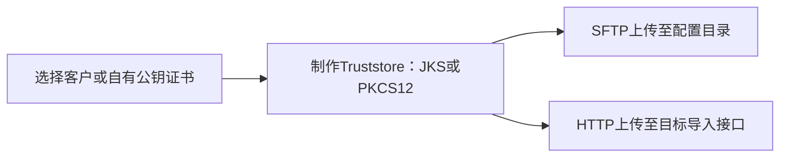

# 服务器管理与证书同步设计

> 后续范围说明（2026-11-14）：本文为通用流程的早期设计。新建入口已调整为三个业务组件加独立 Shell 步骤；旧通用任务继续兼容。本文排除远程 Shell、禁止原始报文持久化等早期边界已被后续 SSH 和加密原始审计需求覆盖，SFTP 移动仍只执行 rename。见[当前核对基线](requirements-design-review-2026-11-14.md)。

> 最新用户调整（2026-11-09）：服务器为内部自管理，SFTP取消主机指纹字段及主机公钥指纹校验。密码认证仅显示密码；KEY认证仅显示SSH私钥、私钥口令，清除凭据选项随当前认证方式切换。本条覆盖下文早期指纹校验要求；HTTPS服务器身份校验继续保持。

日期：2026-11-09  
状态：2026-11-09用户确认，已实现并通过自动化验证；已明确需求与本轮建议分别列出  
技术基础：现有 Spring Boot 单体、Vue 3、H2、加密凭据服务及管理员会话

## 1. 已明确的需求

- 新增服务器管理，支持SFTP和HTTP接口两种配置，可测试连通性。
- 服务器具有别名，同步任务通过别名选择并引用连接配置。
- 新增同步管理，任务为可编辑流程；可定时执行，也可立即执行。
- 流程组件包括制作Keystore、制作Truststore、SFTP上传、HTTP接口调用。
- 制作组件选择客户或自有证书，支持JKS和PKCS12两种格式。
- Keystore私钥条目使用含私钥的自有证书及其上级链；客户证书只能作为可信证书条目。

## 2. 本轮建议与实现边界

采用顺序步骤流程，可增加、删除、复制和上下移动组件。步骤按序执行，失败即停止，后续步骤标记跳过。一个流程可包含多个制作与上传组件，一个产物可供多个后续上传组件使用。暂不增加分支、循环、任意脚本、远程Shell、自动服务重启和远程应用专用导入指令。

实现方式沿用项目单体，在现有数据库保存任务、步骤和执行记录。相比引入独立工作流服务，该方式适合当前单机部署；相比直接保存任意JSON脚本，固定组件可提供字段校验和明确的证书引用关系。图形节点拖线编辑器后续扩展，第一版使用步骤卡片加配置面板。

“导入指定服务器”在通用组件中指上传文件或调用目标HTTP导入接口。SFTP上传成功表示文件已写入指定位置，不能据此宣称远程Java进程已加载证书；若目标需刷新，可追加HTTP调用组件。HTTP响应必须符合配置的成功判定才算步骤成功。

## 3. 菜单和页面

新增一级菜单“服务器管理”“同步管理”，保留其他现有菜单。

服务器列表：别名、类型、地址、启用状态、最近测试结果、更新时间、操作。支持新建、编辑、测试、启用/停用、删除。别名去除首尾空白后全局唯一，忽略大小写。列表及编辑接口不回传已保存秘密。

同步列表：名称、描述、定时开关、Cron、时区、上次结果、下次执行时间、操作。操作包括编辑、立即执行、执行记录、启用/停用定时和删除。禁用定时仍可立即执行；服务器被停用时不能执行引用它的步骤。

任务编辑：基本信息、定时设置、有序步骤卡片、组件参数面板、保存草稿/校验保存。卡片显示序号、组件类型、步骤名称、输入来源及输出产物。选择服务器时显示别名、类型和地址，只能选择与组件协议一致的服务器。

示例流程（一个制作产物可被多个上传步骤引用）：

该图表示产物引用关系；步骤仍按列表顺序执行，例如B、C、D，C失败则D跳过，不并行执行。

执行详情：触发方式、配置版本、状态、时间、步骤结果、上传位置、字节数和脱敏错误；不显示密码、认证头、私钥或请求文件内容。

## 4. 服务器配置

### 4.1 通用字段

别名、类型、描述、启用状态、连接超时（默认10秒）、读写超时（默认30秒）、配置修订号。任务保存稳定的服务器ID，界面使用别名引用；重命名别名不破坏引用，历史执行保留当时的别名。

### 4.2 SFTP

主机、端口（默认22）、用户名、认证方式（密码或SSH私钥）、密码/SSH私钥/私钥口令、SSH主机公钥SHA-256指纹。必需校验主机指纹，不自动信任首次连接。与证书管理中的X.509私钥分开保存SSH认证私钥。

测试只建立SSH连接、校验指纹、认证并打开SFTP会话，不创建或上传测试文件。成功不代表任意目标目录都可写；目录权限在实际上传时检查。

### 4.3 HTTP

基础地址（HTTP或HTTPS）、认证方式（无/Basic/Bearer）、用户名、密码或令牌、固定请求头。认证头和声明为秘密的请求头加密存储，不在日志中输出。HTTPS默认校验服务器证书和主机名；可选从客户证书中选择额外信任CA，不能关闭校验。

连通性测试单独配置测试路径、GET或HEAD方法及预期状态码，默认HEAD `/` 和200–299。测试不复用可能改变目标数据的上传请求。TLS、认证、超时和状态码分别给出脱敏结果；拒绝自动跳转，避免凭据转发到另一目标。

基础地址可为内网IP或域名，连接由后端发起。步骤只能使用服务器基础地址下的相对路径，不允许通过步骤URL或请求头更改目标主机。请求头禁止手工覆盖Host、Content-Length等由客户端管理的字段。

### 4.4 凭据保存和配置引用

复用现有AES-GCM主密钥管理。读取只返回是否已配置，留空保留原秘密，明确“清除”才移除。配置更新采用修订号检查，防止两个管理员互相覆盖。被未删除任务引用的服务器不得删除或变更协议类型，可编辑连接参数和停用。

## 5. 组件配置

### 5.1 制作Keystore

- 格式：JKS或PKCS12；输出文件名、输出标识、Store密码。
- 私钥条目：选择一个或多个含私钥的自有证书，指定每个条目的别名。每条写入当前证书私钥及当前证书至根的链，不写入子证书或上级私钥。
- 可选可信条目：选择客户或自有公钥证书，明确是否包含上级链。默认只包含选中证书；包含上级链时逐证书生成条目，不误用成私钥链。
- JKS支持独立Key密码，默认与Store密码一致；PKCS12第一版统一使用Store密码作为Key密码，避免目标应用兼容差异。该选择参考 [Oracle keytool文档](https://docs.oracle.com/en/java/javase/24/docs/specs/man/keytool.html) 对第三方工具密码兼容性的说明。
- 私钥条目至少一个，客户证书不能进入私钥条目选择器。

### 5.2 制作Truststore

- 格式：JKS或PKCS12；输出文件名、输出标识、Store密码。
- 选择一个或多个客户或自有公钥证书；每项指定别名和是否包含上级链，默认只加入选中证书。
- 禁止加入任何私钥。别名忽略大小写去重，同一证书指纹不重复加入。
- 包含上级链时展示最终条目预览，为上级条目生成可编辑且唯一的别名。执行时使用保存后的确定条目清单。

制作组件不能覆盖现有Store文件，也不接收外部Store文件；每次执行创建新的产物。Store密码和Key密码加密保存，配置JSON与执行快照只保存秘密引用。

### 5.3 SFTP上传

- 选择SFTP服务器别名。
- 输入为一个前序制作组件的输出，或直接导出某张证书（PEM单证书/PEM上级链/DER/P7B）。不提供未加密裸私钥导出；含私钥传输必须先制作Store。
- 目标目录、文件名、覆盖策略：存在则失败（默认）/覆盖。
- 不自动创建目录。使用同目录唯一临时文件上传完成后重命名；失败尽力清理临时文件。不同服务器的重命名/覆盖能力可能不同，不支持时返回失败，不静默退化为先删除正式文件。
- 文件名不能包含目录分隔符；目标目录不允许`..`路径段。目标目录配置为明确远程路径，不接受任意脚本或命令。

### 5.4 HTTP接口调用

- 选择HTTP服务器别名、相对路径、POST/PUT/PATCH方法、查询参数、额外非秘密请求头。
- 请求模式：multipart文件上传、二进制请求体、JSON请求体。multipart可配置文件字段名和普通文本字段；二进制可配置Content-Type。
- multipart/二进制文件可取前序制作产物或直接导出的公钥证书。JSON支持固定文本及显式的证书/文件Base64占位符，不支持任意表达式、脚本或读取系统文件。
- 默认成功状态为200–299，可配置明确状态码集合；可选简单JSON字段路径及预期字符串，路径只支持对象字段/数组索引，不执行表达式。
- 响应体仅在内存中受限解析，记录状态码和成功判定，不持久化原始响应体。禁止自动跳转。

前序产物引用保存稳定步骤ID，不保存步骤位置；移动步骤时重新验证输入必须来自更早的步骤。删除被引用步骤应阻止并指出引用位置。

## 6. 定时、立即执行和失败规则

任务定时使用Spring六字段Cron和IANA时区，默认Asia/Shanghai；界面显示未来三次时间以避免表达式误解。Cron通过同一后端解析器校验。

定时与立即执行均先在短事务内校验并创建执行记录，再交给后台线程运行，HTTP请求不等待远程上传结束。同一任务最多一个QUEUED或RUNNING实例，重复点击或定时重叠返回“已有执行中任务”。多次立即执行请求具有请求幂等键。

以数据库执行记录及租约控制去重，记录任务ID、计划触发时刻，唯一约束阻止同次调度重复创建。任务编辑后重新计算未来调度时间；第一版不补发系统停机期间错过的执行。

每次执行冻结流程配置、证书资产ID/指纹、服务器非秘密配置及秘密版本引用。编辑流程或服务器不影响已排队/执行中的实例；旧秘密版本保留到实例结束。禁止删除正在使用的证书及服务器。启用或立即执行前必须完成全部引用与配置校验，不能运行草稿。

服务器停用优先于冻结配置：禁止新入队，每个传输步骤开始前再次检查服务器是否启用；已建立的网络调用不强行中断。停用导致尚未开始的传输步骤失败并停止流程。其余连接参数仍使用执行快照，不能悄悄切换到编辑后的目标。

步骤状态PENDING/RUNNING/SUCCESS/FAILED/SKIPPED，执行状态QUEUED/RUNNING/SUCCESS/FAILED/INTERRUPTED。首个失败停止后续步骤，已发生的远程写入不自动回滚。第一版不自动重试上传或HTTP调用；用户处理后可重新执行完整流程。超时可能已在远端生效，记录结果不确定提示。

进程重启后，失去租约的执行记为INTERRUPTED，不自动重放远程操作。正在运行任务不能编辑删除执行快照；任务可保存新配置，下次执行生效。

## 7. 证书与产物生命周期

任务引用固定证书资产ID，不按CN自动选择新证书。客户新旧证书并列仍保留；更新任务需手工切换选择。被未删除任务引用的证书禁止删除，错误信息显示任务名。

创建/保存任务可使用尚未生效或已过期材料作为草稿；启用或执行时阻止已删除、未生效和过期材料，也检查私钥条目所需私钥和完整链。信任条目所包含的上级也属于正式引用。

实施取舍：使用受限内存保存产物，以步骤ID引用，不落临时磁盘，也不存数据库或提供下载。单个Store不超过10MB，一次执行累计产物不超过25MB，结束清零持有的产物字节数组。用户文件名仅作为传输文件名，不参与本地路径拼接；私钥不写明文文件。

## 8. 数据表方案

后续使用新增Flyway迁移，不修改已发布V1/V2。下表为设计字段，实施时补齐FK、CHECK和索引。

| 表 | 主要字段与约束 |
| --- | --- |
| managed_servers | id、alias、alias_key唯一、type、description、enabled、config_revision、current_config_id、deleted_at、created/updated_by、时间 |
| managed_server_configs | id、server_id、revision、public_config_json、secret_bundle_id、created_at；server_id+revision唯一，不可变配置版本 |
| managed_server_trust_certificates | server_config_id、source_asset_id、material_id；HTTP额外信任CA的显式来源与材料FK，保存选定客户链CA节点，禁止只在JSON存ID |
| sync_secret_bundles | id、ciphertext、nonce、encryption_key_id、created_at；认证凭据/Store密码的加密集合，API不回传明文 |
| sync_tasks | id、name、description、state(DRAFT/READY)、schedule_enabled、cron、timezone、config_revision、next_fire_at、deleted_at、created/updated_by、时间 |
| sync_task_steps | id、task_id、step_key、position、component_type、name、config_json、secret_bundle_id；task_id+step_key及task_id+position唯一 |
| sync_step_servers | step_id、server_id；显式FK，用于引用校验，禁止仅靠JSON字符串查引用 |
| sync_step_certificates | step_id、source_asset_id、material_id、entry_alias、entry_role、include_chain；客户仅有叶子资产，上级链节点通过来源资产+确定材料引用；链展开后的每项均保存引用，私钥条目与可信条目明确区分 |
| sync_step_inputs | step_id、source_step_id；同任务且前序校验，公钥直接导出使用证书引用表及组件config |
| sync_runs | id、task_id、trigger_type、scheduled_for、request_key、task_revision、status、snapshot_json、lease_owner/until、started/finished_at、error_summary；计划触发唯一、每任务活跃执行唯一由数据库事务锁控制 |
| sync_run_certificates | run_id、source_asset_id、material_id、fingerprint；执行中独立引用，包含Store材料和HTTP信任CA，编辑任务不能移除这部分保护 |
| sync_run_servers | run_id、server_id、server_config_id；冻结连接版本及引用 |
| sync_run_secret_bundles | run_id、secret_bundle_id；显式FK保护执行所需认证、Store/Key密码版本，不能仅在快照JSON保存秘密ID |
| sync_run_steps | id、run_id、step_key、position、type、status、started/finished_at、result_json、error_summary；run_id+step_key唯一 |

流程配置修订号仅用于并发编辑与执行快照，不改变既有“证书不做版本”的规则。任务和服务器逻辑删除，历史执行保留。秘密版本不进入普通快照JSON，受执行FK保护；第一版保留旧加密配置，不自动清理历史秘密版本，后续可增加受引用约束的清理任务。

现有证书删除校验新增未删除任务的sync_step_certificates、当前未删除服务器配置的managed_server_trust_certificates及活跃sync_run_certificates检查。按source_asset_id保护来源资产，并按material_id保护被客户链或HTTP信任配置引用的同材料自有资产；只保留历史快照的终结执行不阻止删除。所有相关创建、保存、入队和删除在同一数据库锁顺序内完成，避免校验与删除间隙。任务/服务器删除保留关联历史，但停止未来定时触发。

## 9. 接口与模块

后端新增`server`、`sync`业务模块；前端新增对应views及流程组件表单，复用现有管理员鉴权、CSRF和错误提示。

| 接口 | 功能 |
| --- | --- |
| GET/POST /api/v1/servers | 列表/创建 |
| GET/PUT/DELETE /api/v1/servers/{id} | 脱敏详情/更新/引用校验后删除 |
| POST /api/v1/servers/{id}/test | 使用保存配置测试，返回脱敏结果及耗时 |
| GET/POST /api/v1/sync-tasks | 列表/创建草稿 |
| GET/PUT/DELETE /api/v1/sync-tasks/{id} | 完整流程详情/事务更新/逻辑删除 |
| POST /api/v1/sync-tasks/{id}/validate | 引用、组件、依赖顺序、Cron和Store条目预览 |
| POST /api/v1/sync-tasks/{id}/execute | 幂等入队，返回202及执行ID |
| GET /api/v1/sync-tasks/{id}/runs | 执行历史分页 |
| GET /api/v1/sync-runs/{id} | 实例及步骤结果 |

更新接口提交configRevision，过期版本返回409；被引用删除返回409及引用名称。测试、触发、执行结果写审计事件；请求体和秘密禁止写日志。

## 10. 验收标准

1. 两类服务器可创建编辑、脱敏回显并测试；错误SFTP指纹及无效HTTPS信任必须拒绝连接。
2. 生成JKS/PKCS12后重新读取，验证别名、证书数量、链顺序、私钥匹配和Store/Key密码；Truststore无私钥。
3. 客户证书不能制作私钥条目；不同客户同CN不会选错资产，按ID和指纹区分。
4. 流程可保存重开、移动步骤；非法前向产物引用、重复别名、类型错误、缺失凭据不能启用。
5. 使用本地测试SFTP/HTTP目标验收实际文件上传、覆盖冲突、multipart字段、请求体及响应判定；连通测试不上传证书或改变远端数据。
6. 验证立即执行、Cron时区、同任务互斥、失败中止、重启中断、修改配置不影响既有快照和临时文件清理。
7. 被任务或活跃执行引用的证书/服务器不能删除；已删除或过期证书不能执行。
8. 密码、令牌、私钥和Store密码不出现在列表接口、执行快照或日志中。实际目标系统的导入与刷新需提供对应HTTP契约验收。
